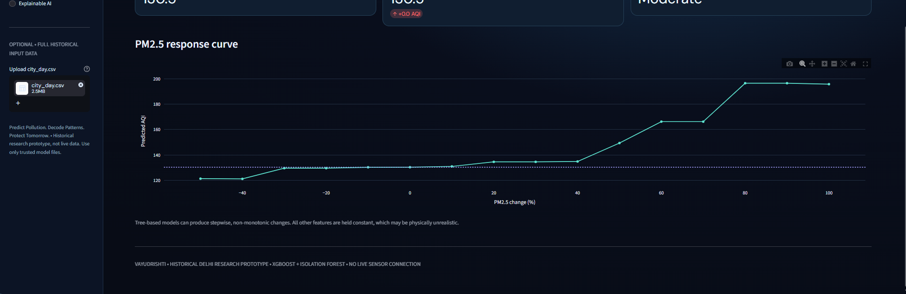
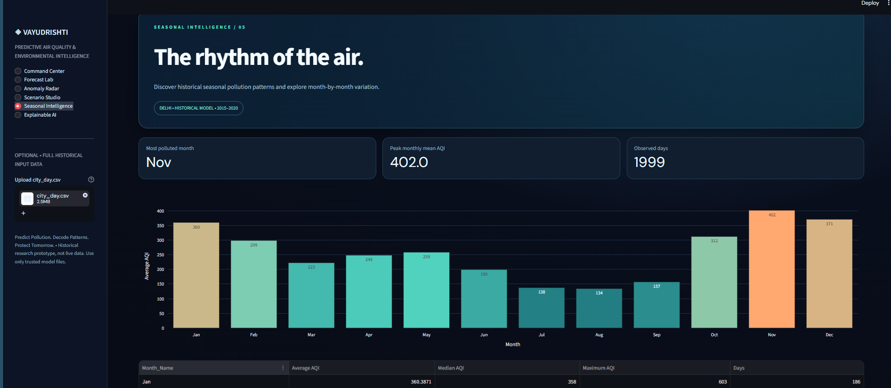
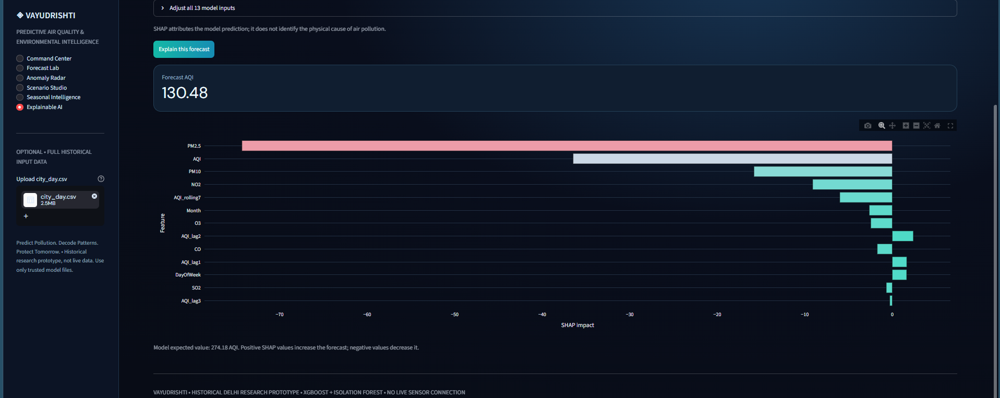

# VayuDrishti 🌫️
### Predictive Air Quality & Environmental Intelligence

**Predict Pollution. Decode Patterns. Protect Tomorrow.**

VayuDrishti is an interactive, dark-themed Streamlit application for **historical Delhi air-quality intelligence**. It combines next-day AQI forecasting, unusual-pollution-pattern detection, sensitivity experiments, and explainable machine learning.

> **Research prototype:** Trained on Delhi observations from **2015–2020**. This is **not a live forecast** and is not validated for current conditions.

## Features

| Dashboard | Function |
| --- | --- |
| **Command Center** | Actual vs predicted AQI, model accuracy, predicted risk bands |
| **Forecast Lab** | Forecast next-day AQI from historical observations or manual inputs |
| **Anomaly Radar** | Identify unusual pollutant combinations using Isolation Forest |
| **Scenario Studio** | Adjust pollutant levels and explore *model sensitivity* (not causal impact) |
| **Seasonal Intelligence** | Explore month-wise AQI patterns in historical Delhi data |
| **Explainable AI** | SHAP feature contributions for an individual prediction |

## Results

The forecasting model was evaluated using a **chronological 80/20 split** (1,598 training observations, 400 held-out test observations). Its target is the **following day's AQI**.

| Model | Test MAE | Test RMSE | Test R² |
| --- | ---: | ---: | ---: |
| Persistence baseline (tomorrow = today) | 31.52 | — | — |
| Random Forest | 26.28 | 36.46 | 0.90 |
| **XGBoost (deployed)** | **25.80** | **35.88** | **0.90** |

XGBoost reduced MAE by approximately **18.1%** compared with the persistence baseline. Results describe historical held-out performance, not a real-time guarantee.

## Tech stack

**Python · Streamlit · Pandas · Plotly · XGBoost · scikit-learn · Isolation Forest · SHAP**

## Installation

Requires a compatible Python environment. The included preprocessing and anomaly pipelines were serialized using **scikit-learn 1.6.1**; `requirements.txt` pins that version to avoid deserialization errors.

```bash
# From the VayuDrishti folder
python -m venv .venv
```

**Windows (PowerShell):**

```powershell
.venv\Scripts\Activate.ps1
python -m pip install -r requirements.txt
python -m streamlit run app.py
```

**macOS / Linux:**

```bash
source .venv/bin/activate
python -m pip install -r requirements.txt
python -m streamlit run app.py
```

If you already installed a different scikit-learn version globally, **use the virtual environment above** rather than modifying other projects.

## Project structure

```text
VayuDrishti/
├── app.py
├── requirements.txt
├── README.md
├── .gitignore
├── run_windows.bat
├── models/
│   ├── airguard_xgboost.json
│   ├── airguard_imputer.pkl
│   ├── airguard_anomaly_pipeline.pkl
│   └── airguard_features.json
├── data/
│   ├── city_day.csv
│   ├── airguard_forecasts.csv
│   └── airguard_anomalies.csv
├── Dashboard1(3).png
├── Dashboard2(3).png
├── Dashboard3(3).png
├── Dashboard4(2).png
├── Dashboard5(2).png
├── Dashboard6.png
├── Dashboard7.png
└── Dashboard8.png
```

**Model loading:** XGBoost is loaded from its native JSON representation, not the fragile original XGBoost pickle. The trained imputer and Isolation Forest pipeline are still trusted pickle files and must be loaded in a compatible environment.

## Data source

The original India air-quality dataset is available on [Kaggle — Air Quality Data in India](https://www.kaggle.com/datasets/rohanrao/air-quality-data-in-india). This repository includes `data/city_day.csv` for reproducible historical input exploration. The application filters to **Delhi**.

## Interpretation and limitations

- Forecasts require same-day measurements and historical AQI lag values; they do not ingest live sensors.
- Scenario controls represent **model response**, not the expected real-world effect of an intervention.
- Isolation Forest anomalies are unusual readings, **not verified pollution events**.
- SHAP explains model predictions, **not causal mechanisms**.
- The warning threshold is a simple AQI threshold, not a calibrated risk probability.
- Only load included `.pkl` files from sources you trust; Python pickle deserialization can execute code.

## Application Screenshots

The screenshots below show the six interactive modules of VayuDrishti. All image files are stored **in the repository root**, alongside `README.md` (not inside a `screenshots` folder).

### 01 · Command Center
Historical actual-versus-predicted AQI trends and key model performance metrics.


### 02 · Forecast Lab
Generate next-day AQI predictions from historical measurements and inspect the 13 model inputs, AQI category, and threshold alert.


### 03 · Anomaly Radar — Historical Trends
Explore the historical AQI timeline with anomalous observations highlighted by Isolation Forest.


### 04 · Anomaly Radar — Observation Analysis
Inspect flagged historical events and analyze a manually entered pollutant observation.


### 05 · Scenario Studio — Interactive Controls
Adjust pollutant inputs and compare the baseline prediction with a hypothetical model scenario.


### 06 · Scenario Studio — PM2.5 Response Curve
Visualize how the forecast model responds to changing PM2.5 values while other inputs remain fixed. This is a sensitivity analysis, **not a causal estimate**.



### 07 · Seasonal Intelligence
Compare historical monthly AQI averages and identify seasonal pollution patterns in Delhi.



### 08 · Explainable AI — SHAP
Inspect feature-level contributions to an individual AQI forecast, including PM2.5, prior AQI, and PM10.



## Author

**Apurv Singh** · [GitHub](https://github.com/devilapurv)
